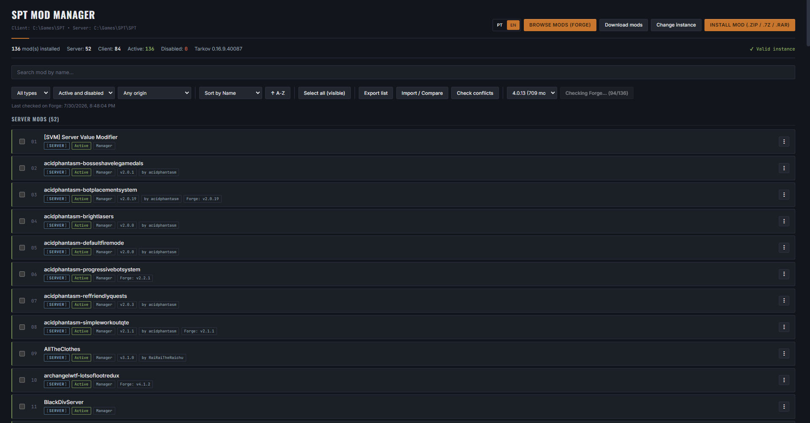
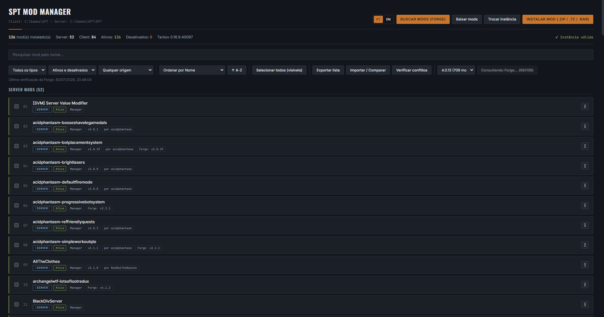

# SPTarky Mod Manager — Spicy Edition

A **Vortex / Mod Organizer 2**-style mod manager built specifically for **Single Player Tarkov (SPT)** — for one install, a Fika headless client beside it, and a group of friends playing on the same host.

A desktop app (Electron + React + TypeScript) that installs, updates, organises, enables/disables and removes mods without manually messing with folders, while staying compatible with mods you installed by hand. Works with **SPT 4.0 and 4.1** (tested on 4.0.13 and 4.1.6).

**[Download the latest release](https://github.com/cspicer5/SPTarky-Mod-Manager-Spicy/releases/latest)** — extract the zip anywhere and run `SPTarky Mod Manager Spicy.exe`. After that, the app updates itself.

Styled with its own "tactical manifest" look — condensed headers, monospace technical data, a warm accent colour — rather than a generic dark-mode template.

> ⚠️ Personal project, not affiliated with the SPT team or Battlestate Games. Tarkov and Escape from Tarkov are trademarks of their respective owners. ⚠️

---

## Credits — with thanks to TioEmir

This is a fork of **[SPT Mod Manager](https://github.com/Nevek20/SPT_Mod_Manager)** by **Matheus Guida (TioEmir)**, released under the MIT licence. Thanks to him for building it and for putting it out under a licence that made this possible.

The foundations are his: the installer, package handling, conflict detection, archive hardening and the original interface. This fork started by fixing how mods are matched against the catalogue, and has since grown the rest of what is described below.

**If you want the original, get it from [Nevek20/SPT_Mod_Manager](https://github.com/Nevek20/SPT_Mod_Manager).** This fork does not track its releases. Bugs here are this fork's — please do not report them upstream.

---

## What it does

**Install and organise**
- Install from `.zip`, `.7z` or `.rar`, by file picker or drag-and-drop. The format is read from the file's contents, not its name, because a catalogue download URL often has no meaningful extension.
- Structure detection that copes with mods wrapped in extra folders, and asks — showing the archive's contents — instead of guessing when a layout is unusual
- Enable/disable without deleting, cascading across a mod's client and server halves and its prepatchers
- Rename a mod's display name without touching any file
- Post-install verification, file by file, before reporting success

**Know what is installed**
- **A version ledger.** The app records the version it actually installed and trusts that over what a mod claims about itself — authors routinely forget to bump the number inside their files. If the files change underneath it, the record is marked stale rather than believed.
- **Mod identity read from the assemblies**, not guessed from names: `[BepInPlugin]` on client plugins, the mod metadata on server mods
- SPT version detected from the install itself

**The catalogue** — [sp-mod.com](https://sp-mod.com)
- Update checking with per-mod status, and **Update all**
- Browse and search in-app, install in one click, with version lists filtered to your SPT version
- **Dependency checks** when installing, and a sweep of the whole install
- **"It works on {SPT}"** — authors pin builds narrowly, so a mod can be reported as incompatible with an SPT version it runs fine on. Accept it for that exact build on that exact SPT version and it stops being flagged; it asks again if either changes.
- Never offers a years-old build just because it declares no SPT version at all

**Addons** — patches and compatibility mods that attach to another mod
- Offered for the mods you have, at the build that fits the parent version you have installed
- What each addon changed inside its parent is recorded, so the app can tell **present**, **missing** and **replaced** (the parent was reinstalled over the patch) apart
- Reinstall one or all, updates folded into the main update check, and a way to say "this folder is really that addon" when one has been mistaken for a mod

**Presets and sharing**
- Save, compare and apply a whole modlist
- Share through a folder (network share, VPN path or synced directory) or as a single `.sptpreset.json` file
- Presets can **carry the mod files themselves**, so applying one needs no catalogue and no downloads
- **Bulk reinstall** of every mod at the right version for a chosen SPT version — from the catalogue or from GitHub releases — with configs backed up and restored and disabled mods left disabled

**Playing together** — see [The server companion](#the-server-companion)
- Compare your install against a host's, row for row: server mods, client plugins, addons, and optionally prepatchers
- **Match server** — install exactly the builds the host runs, pulled from the host itself, with the catalogue as an announced fallback
- **Lock to server** — set the app's SPT version to the host's, so catalogue lookups target what the host runs (and say so plainly if your own install is on a different SPT)
- **Bundle sync** — pull the host's asset bundles in bulk instead of trickling them in mid-raid

**Fika headless client** — see [Dual instance](#dual-instance--spt--fika-headless)
- Manage a headless client side by side with the main install, with a parity report between them
- One-click sync of plugins, their config, and their addons

**Keeping itself current**
- Updates itself from this repository's releases. Pre-release test builds are never offered automatically.

---

## What's different in this fork

| | Original behaviour | Here |
|---|---|---|
| Mod → catalogue matching | name-derived, fuzzy | GUID-first, read from assembly metadata |
| Match rate (54-mod reference install) | 27/53 (51%) | **54/54 (100%)** |
| Wrong matches | ~4, silently presented as correct | 0, with guesses flagged for confirmation |
| Mods with no readable version | 13 of 54 | **0 of 54** |
| Language | pt-BR + English | English only |

The headline fix in the first release: the update check sent `filter[include_legacy]` alongside every other filter, and the API silently ignored all other filters when that flag was present — returning the unfiltered catalogue with HTTP 200. That killed GUID batching, ID batching and name lookup at once, leaving only a last-resort full-text search.

The principle that came out of it runs through the whole app: **nothing is asserted that isn't known.** Every match records how it was made — `manual`, `guid`, `cached-id`, `name`, `sibling`, `fuzzy` — and anything unverified is shown as "needs confirmation" rather than presented as fact. Guesses are never cached, and a match you set by hand outranks all of them.

---

## The catalogue: Forge, and what replaced it

SPT Forge shut down on **10 August 2026**. The app moved first to a mirror at `forge-alt.katrinfoxvr.com` (v1.3.0), then — when Forge was rebuilt — to **[sp-mod.com](https://sp-mod.com)** (v1.4.3), which it reads today. Both carried over Forge's numeric mod ids, GUIDs and `/api/v0` surface, so neither move needed a single mod re-matched. The mirror has since gone offline.

The catalogue's address is a setting rather than a release — see `electron/registry.ts` — so another move needs no update.

Differences that would fail **silently**, handled in code and covered by tests (`test:registry`, `test:sptpick`, `test:constraints`):

- Mod pages are `/mods/<slug>`; **addon pages are `/addon/<id>/<slug>`** — singular, and by id. Nothing builds a page URL the site does not serve.
- The category label is keyed `name`, where Forge used `title`. Reading the wrong one is indistinguishable from "no category".
- Filtering mods by SPT version filters the *mod*, not each version, so the app re-filters version lists itself.

And quirks that are known rather than worked around:

- Version lists come back **newest-first from one endpoint and oldest-first from another**, so nothing should rely on list order.
- The addon listing leaves out an addon that has no visible version, and listings are cached for a while — so an addon its author has just re-published can take a few minutes to appear.

**The Forge archive stays.** [`data/forge-directory.json`](data/forge-directory.json) holds **2,389 mods** harvested before the shutdown — id, GUID, owner, category, Fika flag and source URL — including several hundred SPT 2.x/3.x-era mods nothing else records. Its mod → source-repository mapping is what lets update checking fall back to GitHub releases when no catalogue is reachable. [`data/forge-addons.json`](data/forge-addons.json) is the offline fallback for the addon catalogue, which is otherwise read live.

One caveat recorded with the data: `fikaCompatible: true` is meaningful, `false` is not. It is author-declared and widely left unset, so nothing here draws a negative conclusion from it.

The full story is in **[docs/FORGE-SHUTDOWN.md](docs/FORGE-SHUTDOWN.md)**.

---

## The server companion

A stock SPT server can tell another machine which **server** mods it loaded — and only what those mods *declare* about themselves. It cannot report client plugins, the versions actually installed, or hand over any files. So playing together used to mean comparing modlists by hand.

The **SPTarky Companion** is a small C# server mod, built into this app and installed with one click by the app running **on the host** (or by hand from a release's DLLs). It answers a handful of read-only routes:

| Route | Gives |
|---|---|
| `/sptarky/version` | the companion's version, and its capabilities by name |
| `/sptarky/manifest` | the host's server mods and client plugins, plus this app's records from that machine, verbatim |
| `/sptarky/filelist/` · `/sptarky/filedata/` | the files of a mod or addon, byte for byte |

With it, the **server pane** compares a host against your install row for row, and installs what you are missing **from the host itself** — the exact bytes it runs, including mods the catalogue no longer lists. Without it, only server mods can be compared, and the pane says so.

- **Two builds.** SPT 4.0 runs on .NET 9 and SPT 4.1 on .NET 10, and an assembly for one cannot load on the other. The installer picks the right build for the SPT version it detects, and refuses rather than guesses if it cannot tell.
- **Read-only in both directions.** Nothing is ever sent to the host, and nothing on it is changed. A host whose own records are wrong has to be fixed on that machine.
- **An optional access token**, off by default. Switched on without a token set, it refuses everything rather than nothing. This app cannot send a token yet, so switching it on also shuts this app out — leave it off for now.

---

## Dual instance — SPT + Fika headless

A Fika headless client is a second SPT client that hosts raids, so the AI is computed somewhere other than the machine you play on. Managing it means keeping two installs in step, and the rules are not symmetric.

Press **Headless** in the header and the app splits: main install on the left, the parity report down the middle, the headless client on the right.

**The fact that shapes everything**, from [Fika's wiki](https://wiki.project-fika.com/faqandguides/headless-client-faq-and-common-issues/guidance-on-which-mods-should-be-used-on-the-headless-client):

> The headless client is a *client* — clients only load things in `BepInEx/`. Any mod that is in `SPT/user/mods/` is loaded only by the backend server, SPT.Server.exe.

So a server mod is never *missing* from the headless client; it cannot exist there. That settles every server mod structurally, with no judgement involved. What remains is the client plugins, classified from Fika's own decision procedure — stash-or-hideout-only and display-only plugins are not needed; anything altering in-raid behaviour is, because the headless client is the raid host.

| Where a verdict comes from | Strength |
|---|---|
| `manual` | your override — outranks everything |
| `structural` | how SPT loads mods; not a judgement |
| `rule` | named in Fika's guidance |
| `pairing` | its server half is installed, so the shared server will load it |
| `category` | guessed from the catalogue category — marked with `?` |

Measured on the reference setup: **26 of 28 client plugins classified (93%)**, 2 left for the user.

The parity report covers version drift, plugins missing from the host, leftovers on the headless side, menu-patching plugins named in the ruleset (the headless client drives its own menus to enter and leave raids), and server mods copied where nothing will load them. **Sync** copies a plugin across with its prepatchers, its `BepInEx/config` file and its addons, and records what it copied so the headless side reports the right version.

**Prepatchers are compared on their own**, file by file, because a plugin row looks the same whether its prepatcher came with it or not. Each prepatcher is attributed to its mod from the install record where there is one, by name where there is not, and reported as unattributed otherwise. Every prepatcher's assembly references are also checked against `BepInEx/patchers`, `BepInEx/core` and the game's `Managed` folder — one prepatcher can depend on another mod's (BlackDiv's references MoreBotsPrepatch), and when that dependency is missing BepInEx silently skips the patch and the raid crashes later on something that looks unrelated. Sync copies a missing prepatcher when its plugin is on the headless client, when another prepatcher there depends on it, or when nothing says whose it is; it leaves one alone when its known owner was left off the headless client, and never copies SPT's own. A dependency missing from the main install too is reported with the mod to reinstall, where the install record knows it.

The app identifies a headless install by `FikaHeadlessManager.exe` and will not accept an ordinary SPT client, since pointing both halves at the same folder would report perfect parity while nothing was hosting.

---

## Screenshots

These date from an early version — the interface has moved on since.




---

## Getting Started

### Prerequisites
- [Node.js](https://nodejs.org/) 18 or later (developed against 24 LTS)
- Windows — the app assumes Windows-style SPT conventions; untested elsewhere
- An existing SPT 4.x install
- To build the companion: the .NET 9 **and** .NET 10 SDKs, plus an SPT 4.0 and an SPT 4.1 install to compile against

### Development

```bash
git clone https://github.com/cspicer5/SPTarky-Mod-Manager-Spicy.git
cd SPTarky-Mod-Manager-Spicy
npm install
npm run electron:dev
```

`npm install` will report that `electron` and `esbuild` have install scripts pending — both need theirs (they download the Electron runtime and the esbuild binary). Approve with `npm approve-scripts electron esbuild`.

For UI-only iteration, `npm run dev` runs Vite alone. In that mode `window.modManagerAPI` does not exist, so anything touching the backend fails — it is for visuals only.

### Tests and audits

```bash
npm test                                   # 33 suites; checks that need a real SPT install skip when there isn't one
npm run audit:forge -- "D:\SPT"            # catalogue matching against a real install
npm run audit:headless -- "D:\SPT" "D:\SPT_Headless"
npm run audit:server -- <host>:6969 "D:\SPT"   # parity against a live server
```

The audits run the app's real code against a real install and report what they find. `audit:forge` is read-only unless given `--write`.

### Building a release

```bash
npm run build:companion        # both companion builds -> companion/dist/spt4.0 and spt4.1
npm run build                  # renderer + main process
npx electron-builder --win dir "-c.win.signAndEditExecutable=false"
```

Then apply the icon and version details to `release/win-unpacked/SPTarky Mod Manager Spicy.exe` with `rcedit` (it lives in electron-builder's `winCodeSign` cache), and zip the **contents** of `win-unpacked` — files at the root, no wrapping folder — as `release/SPTarky-Mod-Manager-Spicy-win-x64.zip`.

- **Why not `npm run electron:build`?** On Windows, electron-builder extracts a `winCodeSign` bundle containing macOS symlinks, which Windows refuses to create without Developer Mode or elevation, so the build fails before packaging. The command above skips signing entirely.
- **Why not electron-builder's `zip` target?** It repackages `win-unpacked` from scratch, wiping the icon and version details applied afterwards — one early release shipped an exe calling itself "Electron".
- **The zip name has no version in it, on purpose.** It is what the in-app updater downloads, so a fixed name means the updater cannot miss it, and `releases/latest/download/SPTarky-Mod-Manager-Spicy-win-x64.zip` is a permanent link.
- **`build:companion` output is gitignored** and built per release. It needs SPT installs to compile against (SPT publishes no NuGet packages); point it elsewhere with `--spt40` / `--spt41`:

```bash
node scripts/build-companion.js --spt40 "D:\SPT\SPT" --spt41 "D:\SPT41\SPT_Runtime"
```

> **Check `git diff package.json` after a build that FAILED.** electron-builder rewrites `package.json` while it packages and restores it when it finishes. A build that dies partway leaves the trimmed copy in place, silently dropping `scripts`, `devDependencies` and the `build` block — nothing looks wrong until `npm test` reports *"Missing script: test"*. Restore with `git checkout package.json`.

---

## Project structure

```
SPTarky-Mod-Manager-Spicy/
├── electron/              # main process
│   ├── main.ts            # window + IPC handlers
│   ├── preload.ts         # exposes window.modManagerAPI (contextIsolation)
│   ├── modManager.ts      # filesystem, install paths, version ledger, catalogue matching
│   ├── registry.ts        # where the catalogue lives, and how its URLs differ
│   ├── addons.ts          # addon catalogue, ledger and file checks
│   ├── dependencies.ts    # dependency checks
│   ├── preset*.ts         # presets, the shared store, payloads, sync
│   ├── bulkReinstall.ts   # reinstall everything for a chosen SPT version
│   ├── modSources.ts      # GitHub releases as a source
│   ├── headless.ts        # Fika headless classification and parity
│   ├── sptServer.ts       # reading a live SPT server, and server parity
│   ├── companion*.ts      # talking to, and installing, the companion
│   ├── serverFiles.ts     # pulling files from a server
│   ├── bundles.ts         # bundle sync
│   ├── selfUpdate.ts      # the in-app updater
│   └── peMetadata.ts      # reads mod identity from .NET assemblies
├── src/                   # React UI (App.tsx plus a panel per area)
├── companion/             # the C# SPT server mod
├── scripts/               # test suites, audits, harvesters, the companion build
├── data/                  # the Forge archive and the headless ruleset
└── docs/                  # FORGE-SHUTDOWN.md, PRESETS.md
```

---

## How it works under the hood

### Folder conventions
| What | Where |
|---|---|
| Active server mods | `<server root>/user/mods/` |
| Disabled server mods | `<server root>/user/mods.disabled/` |
| Active client mods | `<instance>/BepInEx/plugins/` |
| Disabled client mods | `<instance>/BepInEx/plugins.disabled/` |

The server root is found by what is in it (`SPT.Server.exe`, `user/`) rather than by name, so SPT 4.1 renaming `SPT/` to `SPT_Runtime/` needed no change. Split installs, with client and server in different folders, are handled too.

### Control files (at the instance root)
- `.spt-mod-manager-registry.json` — what the app installed: the version, where that version came from, and a fingerprint of the files
- `.spt-mod-manager-addons.json` — installed addons, their parent, and the files each one changed
- `.spt-mod-manager-forge-match.json` — catalogue identifiers, **with how each was found**
- `.spt-mod-manager-forge-dismissed.json` — updates dismissed as "already have it"
- `.spt-mod-manager-spt-accepted.json` — builds accepted as working on an SPT version the author did not declare
- `.spt-mod-manager-aliases.json` — custom display names
- `.spt-mod-manager-manifest.json` — loose files belonging to a mod but living outside its folder

### Identifying a mod

Against the catalogue, in order of trust:

1. **Manual link** — you said so. Final.
2. **GUID** — read from the assembly. Exact, and batched, so dozens of mods resolve in one request.
3. **Cached id** — resolved by an earlier run, re-validated.
4. **Published name** — an exact match, or one confirmed by the author.
5. **Full-text search** — a guess. Flagged for confirmation, never cached.

A mod that resolves by none of these can inherit a match from another part of the same package. Matching always uses the folder name, never a display alias.

Against a **server**, a mod has three identifiers that look alike and are not interchangeable: the catalogue's package GUID, the GUID the assembly declares, and its folder. Server mods are matched on the declared GUID, then the folder, and only then the catalogue GUID; client plugins on the GUID their assembly declares, then their folder. Comparing a server's *declared name* against a folder name is the one pairing guaranteed to disagree — 40 of 52 mods on a real server did.

### Versions

Read in this order, each tagged with where it came from:

1. **Recorded** — what this app installed, while the files are unchanged since
2. **Declared** by the mod itself
3. **Sibling** — the other half of the same package
4. **Assembly** — the compiled version number; the last resort, since authors often leave it stale

Version comparison is semver with two deliberate exceptions: `+build` tags are ordered (mods use `+pre1`, `+pre2` as a sequence), and trailing zeroes are ignored (`5.3.11` = `5.3.11.0`).

### Rate limits

The catalogue allows roughly 300 requests / 60s per IP and answers `429` with `Retry-After`, which the app honours. Its pacing is stricter than that on purpose: probing hard during development once earned a Cloudflare block on the whole IP. With GUID batching, a 54-mod install resolves in about 3 requests.

---

## Known limitations

- **Mods installed as loose files** (no folder of their own) support only rename and remove — there is no folder to move.
- **The original archive is not kept.** Reinstalling a single mod from a file means picking it again; bulk reinstall fetches from the catalogue or GitHub instead.
- **Conflict detection is file-level**, not semantic — it catches duplicate DLLs and duplicate GUIDs, not two mods fighting over the same loot table.
- **A borrowed sibling version assumes both halves ship together.** True in every case observed, but it is an inference.
- **The companion is read-only.** If a host's own records are wrong, they have to be repaired on that machine.
- **The companion's access token can't be used yet** — this app has nowhere to store one and sends none, so turning it on locks this app out as well.
- **Pre-release builds are never offered by the updater** — install one by hand if you want to test it.
- Only tested on Windows.

---

## Roadmap

**Done**
- [x] GUID-first catalogue matching, with provenance and a "needs confirmation" state; manual links; per-version update dismissal
- [x] Mod identity and server-mod versions read from the assemblies
- [x] Forge catalogue archived ahead of the shutdown, and the move to its successors
- [x] Version ledger — what was installed, not what a mod claims
- [x] Fika headless dual instance: suitability ruleset, parity, one-click sync with config and addons
- [x] Presets: save, compare, apply, share by folder or file, carrying mod files
- [x] Bulk reinstall for a chosen SPT version, from the catalogue or GitHub releases
- [x] GitHub releases as a mod source and an update fallback
- [x] Addons: catalogue, file tracking, reinstall, updates, linking
- [x] Dependency checks
- [x] The server companion, server parity, installing from the host, bundle sync
- [x] SPT 4.1 support
- [x] In-app self-update

**Open**
- [ ] GitHub token support (60 requests/hour unauthenticated, 5,000 with one), stored via Electron `safeStorage`
- [ ] Storing and sending the companion's access token, so a host can switch it on
- [ ] Add-your-own source entries for mods with no known repository
- [ ] Edit the headless ruleset in the app, not just override it per mod
- [ ] Deeper conflict detection (two mods editing the same loot table)
- [ ] New screenshots
- [ ] Linux/macOS support

**Considered and rejected**
- *Keeping the original archive for reinstall* — doubles disk usage for every mod installed. Re-prompting is the better trade, and bulk reinstall covers the common case.
- *Catalogue API tokens* — the API is open and read-only; authentication does nothing. A bogus bearer token gets the same rate limit as none.

**Not planned for now**
- *Installing prepatchers on their own* — paused. The repair for a missing prepatcher is to reinstall its parent mod. (Copying one from the main install to a headless client is not this: that is a sync, from a copy the parent already installed.)

---

## Contributing

Personal project. Issues and PRs welcome; open an issue first for anything large.

## License

[MIT](LICENSE) — retaining the original copyright of Matheus Guida (TioEmir) as the licence requires, with this fork's alongside.

`.rar` extraction is powered by [node-unrar-js](https://github.com/YuJianrong/node-unrar.js), a WASM build of the official UnRAR source — free to use but under its own licence (not MIT); see that package's `LICENSE.md`.
